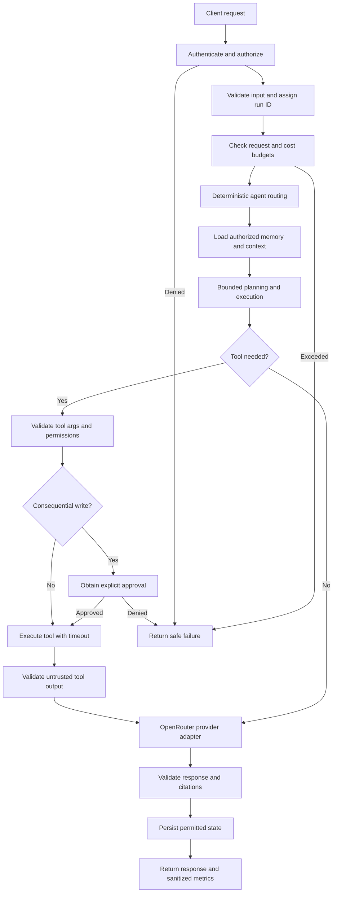
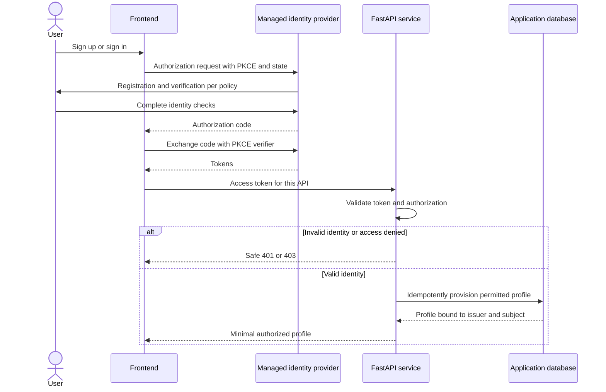
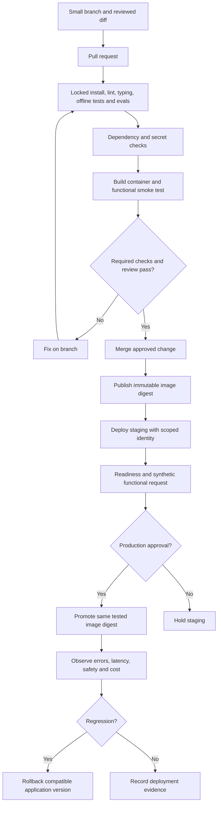

# Operational flows

These diagrams describe the target system, not running services. Registration and CI/CD are not implemented. Database and identity-provider choices are proposed in [decisions.md](decisions.md). Application logs follow [the development logging contract](docs/development.md).

## Agent request pipeline

| Stage | Operational rule | Failure behavior |
| --- | --- | --- |
| API boundary | Validate schema, identity, authorization, and budgets | Return appropriate safe 4xx response |
| Context and memory | Scope by authenticated user/tenant; enforce context budget | Reject forbidden access; handle missing data explicitly |
| Orchestration | Bound iterations and concurrency; carry run ID | Stop on limit or cancellation |
| Tools | Allowlist tools; require approval for writes; bound outputs | Safe error; retry only when transient and side effects permit |
| Provider | Configured model, timeout, token/cost caps | Bounded backoff; never silently bypass policy |
| Output and persistence | Validate structure/citations; persist only permitted state | Report failure honestly; avoid partial-write ambiguity |

All stages emit sanitized outcomes and durations. The simplified diagram omits per-stage error edges; validation, authorization, and dependency failures must end safely rather than falling through to successful output.

## User registration and first access (proposed)

| Step | Control | Acceptance evidence |
| --- | --- | --- |
| Identity enrollment | Provider owns password/recovery and verification policy | Verified registration and recovery paths |
| Browser redirect | PKCE, state validation, exact registered redirect URI; OIDC nonce when applicable | Reject replay and invalid callback state |
| API authentication | Verify signature or provider-supported token verification, issuer, audience, expiry, scopes | Reject malformed, expired, and wrong-audience tokens |
| Profile provisioning | Unique issuer/subject identity; default least privilege; no tenant inference from email alone | Duplicate requests do not create duplicate users |
| Subsequent access | Server-side resource and tool authorization | Cross-user access tests fail safely |

Do not log tokens, passwords, callback codes, or raw identity claims. Database outage must not yield a successful profile response. Rate limiting, account deletion, and revocation behavior must be specified before deployment.

## CI/CD delivery routine (planned)

| Gate | Required evidence | Boundary |
| --- | --- | --- |
| Pull request | Offline tests/evals, lint/types where configured, reviewed diff | No production secrets in fork or untrusted PR jobs |
| Container | Build and synthetic functional request | Open port alone is insufficient |
| Live evals | Explicit opt-in, provider key, model and spend limits | Separate from default offline CI |
| Staging | Immutable artifact, readiness and end-to-end synthetic check | Failure stops promotion |
| Production | Approved promotion, scoped deployment identity, recovery plan | Deploy same tested image; do not rebuild |
| Recovery | Known-good digest and migration compatibility | Destructive migrations require a separate recovery plan |

Future CI should use narrowly scoped permissions and pinned actions. Prefer short-lived federated cloud identity where supported. Do not create workflows, publish images, or deploy merely because this document describes the process.

## Laptop handoff routine
Finish one increment → run relevant checks → update learning log/ADRs/flows → review diff → commit and push the shared branch → on the second laptop fetch and resume from [entrypoint.md](entrypoint.md). Preserve local changes before synchronization; never copy credentials or virtual environments through Git.
